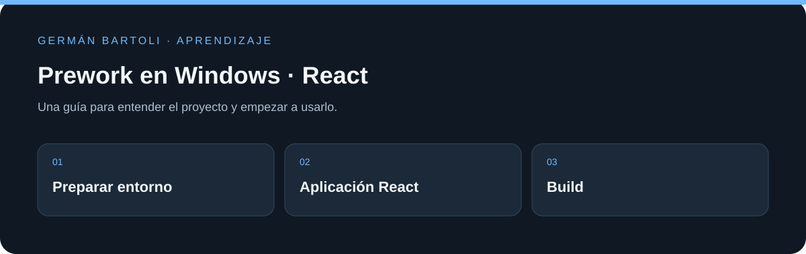

# Prework en Windows · React

**Entorno de práctica con una aplicación React con Vite en `Test-React/`, material del curso y capturas originales.**

[Empezar](#primeros-pasos) · [Mapa del repositorio](#mapa-del-repositorio) · [Autoría](#autoría-de-esta-documentación)

*Esquema de orientación; no representa una captura de la aplicación.*

## Primeros pasos

1. Entrá en `Test-React/` e instalá las dependencias con `npm ci`.
2. Ejecutá `npm start` y abrí la dirección que indique la terminal.
3. Usá `npm test` para las pruebas del proyecto y `npm run build` para generar la distribución.

## Entorno de aprendizaje

Este repositorio conserva ejercicios y versiones de su etapa de estudio. Revisá los archivos de proyecto para preparar el SDK, runtime o servidor correspondiente; esta actualización del README no migra dependencias ni acredita una ejecución reciente de todos los ejemplos.

## Imagenes

*La captura histórica alojada externamente no está disponible. La guía visual de arriba resume los pasos de uso.*

## Mapa del repositorio

- [Test-React/package.json](<Test-React/package.json>)
- [Test-React/index.html](<Test-React/index.html>)

## Autoría de esta documentación

Repositorio mantenido por [Germán Bartoli](https://github.com/GermanBartoli). Guía revisada y actualizada con **Codex**, coautor de esta actualización documental. Los autores, colaboradores, licencias y recursos de terceros conservan sus créditos originales.

Los commits de esta revisión incluyen `Co-authored-by: Codex <noreply@openai.com>`; esta atribución no modifica la autoría del historial anterior.

<!-- firma-german-bartoli -->

  <a href="https://germanbartoli.pages.dev/">
     
    Hecho por Germán Bartoli · Ver portfolio
  </a>

